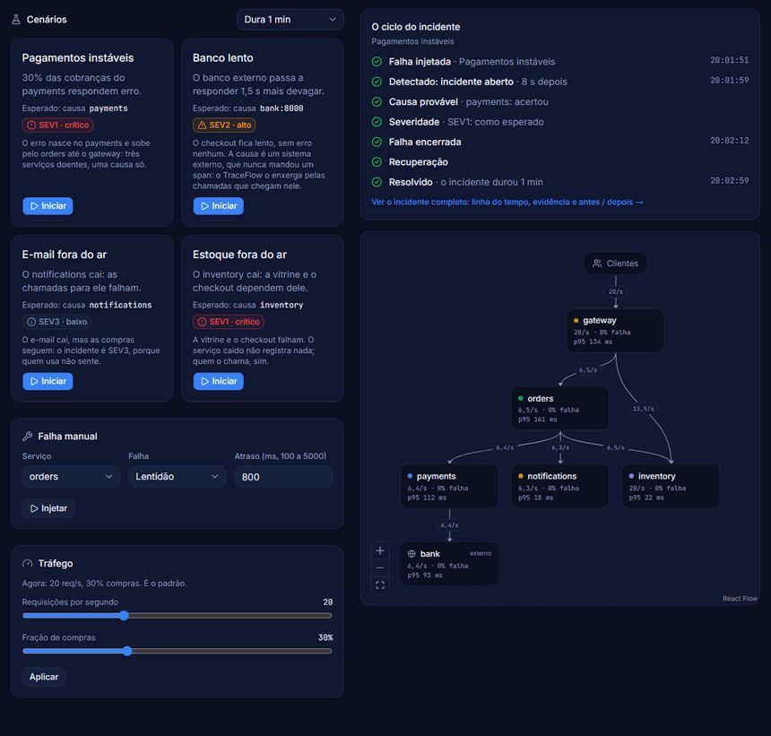
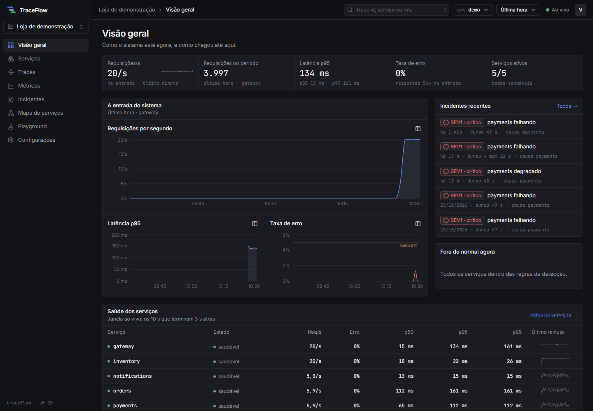
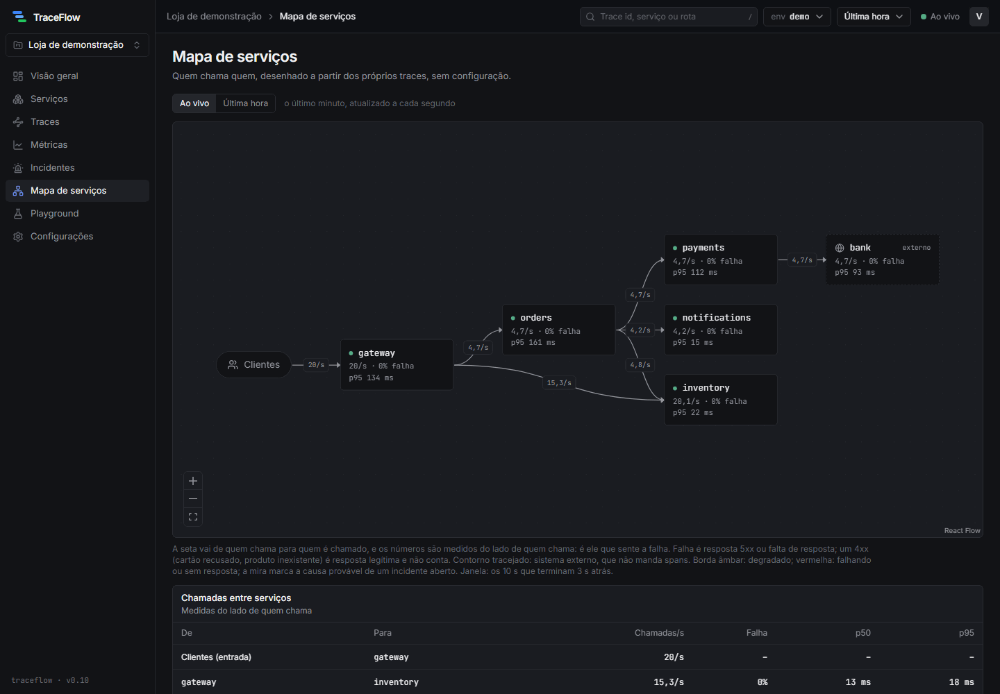
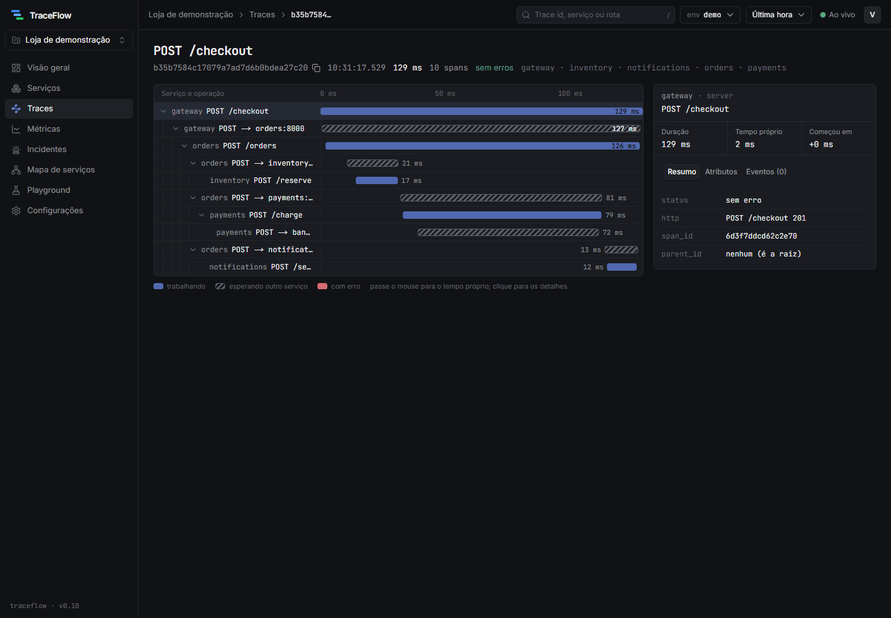
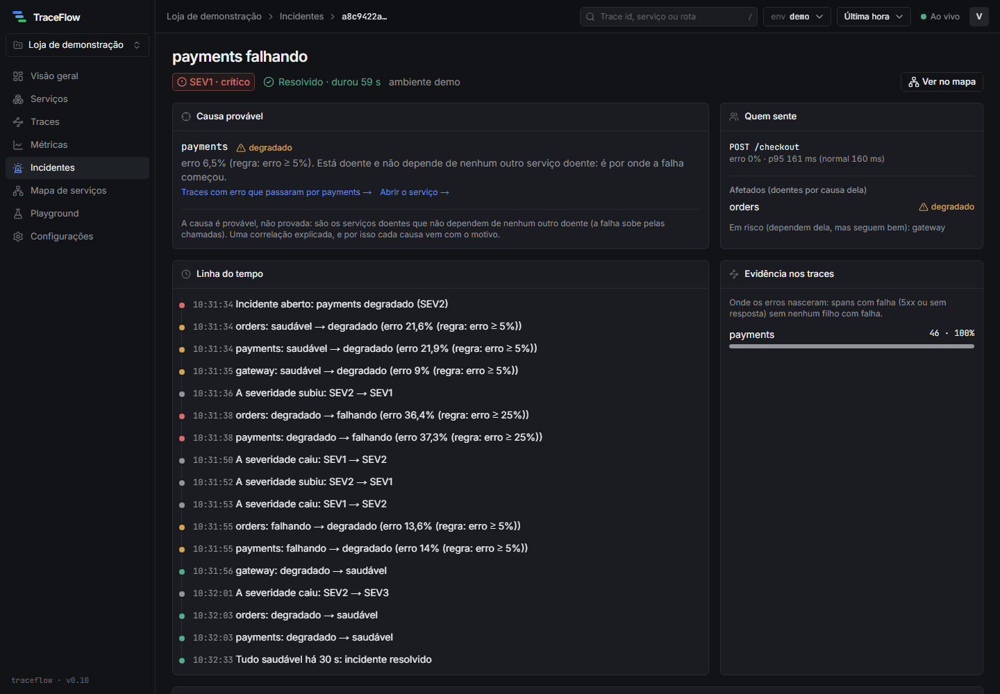
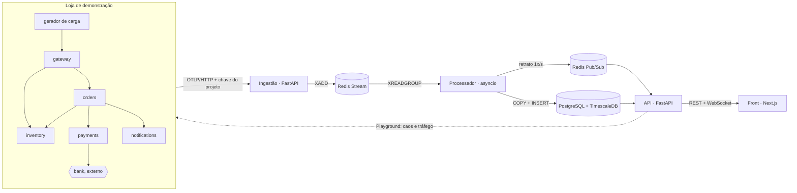

# TraceFlow

[](https://github.com/paulo-carvalho10/traceflow/actions/workflows/ci.yml)

**Real-Time Application Observability Platform**
*Understand your systems. Detect issues faster.*

Plataforma de observabilidade para APIs e microsserviços:
- recebe traces no padrão OpenTelemetry, separados por projeto e ambiente;
- mostra o desempenho de cada serviço em tempo real;
- desenha o mapa de dependências sozinha, a partir dos próprios traces;
- quando algo quebra, abre um incidente com a causa provável, o que foi afetado e a severidade pelo impacto em quem usa, e resolve sozinho quando o sistema se recupera.

O diferencial é o **Incident Playground**: uma loja de demonstração com cinco microsserviços, onde você injeta latência, erros ou derruba um serviço e acompanha a falha se espalhar, ser detectada, ter a causa apontada e se recuperar.



*O ciclo inteiro, acelerado cerca de 4,5 vezes: a falha entra, o incidente abre 7 s depois com a causa e a severidade conferidas, a falha é encerrada, o sistema se recupera e o incidente se resolve.*

## O que tem dentro

| | |
|---|---|
|  |  |
| **Visão geral:** o agora (ao vivo, por WebSocket) e o período escolhido no cabeçalho: tráfego, latência e erro da entrada, incidentes recentes e a saúde de cada serviço | **Mapa de serviços:** quem chama quem, montado pelo pareamento dos spans CLIENT e SERVER, com nós externos (o `bank`, que não manda spans) |
|  |  |
| **Traces e waterfall:** o caminho de uma requisição pelos serviços, separando o tempo trabalhando do tempo esperando, com os detalhes do span ao lado | **Incidentes:** a causa provável com o motivo, quem sente, a linha do tempo e a evidência nos traces |

## Arquitetura



O pipeline é próprio, e não Prometheus + Tempo por baixo: montar o trace, calcular percentis com histogramas, parear chamadas para o mapa e apontar a causa provável são justamente as partes interessantes (D23). O caminho de escrita e o de leitura não se tocam: se a API cair, os dados continuam chegando; se o banco ficar lento, o stream segura os dados e a ingestão pede para os exportadores esperarem.

Os detalhes estão em [docs/ARQUITETURA.md](docs/ARQUITETURA.md), e cada escolha, com as alternativas consideradas e o porquê, em [docs/DECISOES.md](docs/DECISOES.md).

**Stack:** Python 3.12 (FastAPI, asyncio, SQLAlchemy, asyncpg), OpenTelemetry, Redis Streams e Pub/Sub, PostgreSQL + TimescaleDB, Next.js 16 + React 19 + TypeScript, Tailwind + shadcn/ui, React Flow, Docker Compose, GitHub Actions.

## Números medidos

**Detecção** (cenário "Pagamentos instáveis", pela tela, 6 rodadas): o incidente abre **7 a 9 s** depois da falha, sempre com a causa certa; encerrada a falha, ele se resolve sozinho em 44 a 47 s (30 s de carência com tudo saudável, mais a janela de 10 s esvaziando).

**Teste de carga** do pipeline (ingestão → fila → processador → banco), com traces de 8 spans em lotes de 200, num Intel i5-9400F (6 núcleos) com 16 GB, com tudo, inclusive o gerador, na mesma máquina:

| Oferecido (spans/s) | Gravado (spans/s) | Atraso p95 até o banco |
|---|---|---|
| 1.000 | 1.098 | 0,47 s |
| 2.000 | 2.108 | 0,44 s |
| 4.000 | 4.097 | 0,47 s |
| 8.000 | 7.972 | 1,51 s |
| 16.000 | **14.666** | 4,64 s |

- O gravado inclui os ~45 spans/s da loja, que segue rodando.
- No último degrau, quem não deu conta foi o gerador, que divide os núcleos com o resto: os 14.700 spans/s são um piso, não o teto.
- Acima do que o processador aguenta, a **contrapressão** age: a ingestão responde 503 (com `Retry-After`) quando o lote mais antigo da fila passa de 30 s de espera, e a fila para de crescer em vez de esgotar a memória (D65).
- O teste mostrou que o processador passava 72% do tempo esperando o banco gravar, uma leitura por vez. Com duas leituras em andamento no mesmo processo, a vazão subiu 76% (D66).

## Rodando

Precisa só do Docker.

```bash
docker compose up -d --build
```

| O quê | Onde |
|---|---|
| **O TraceFlow** (entre como visitante, sem cadastro) | **http://localhost:3000** |
| A API e a documentação interativa | http://localhost:8000/docs |
| A ingestão (OTLP/HTTP) | http://localhost:4318/v1/traces |
| As métricas do próprio TraceFlow (Prometheus) | http://localhost:9101/metrics (ingestão), :9102 (processador), :9103 (API) |
| A loja | http://localhost:8100/products |

Opcionais: `docker compose --profile prometheus up -d` sobe um Prometheus lendo as métricas (http://localhost:9090), e `--profile jaeger` sobe um Jaeger para comparar.

### Mandando spans de uma aplicação sua

Crie uma conta, um projeto e uma chave de ingestão pela tela (a chave aparece uma vez só). Depois, na sua aplicação instrumentada com OpenTelemetry:

```bash
OTEL_EXPORTER_OTLP_TRACES_ENDPOINT=http://localhost:4318/v1/traces
OTEL_EXPORTER_OTLP_HEADERS=Authorization=Bearer%20<a sua chave>
OTEL_RESOURCE_ATTRIBUTES=deployment.environment.name=desenvolvimento
```

### Injetando falhas

Pelo **Incident Playground**, no menu: escolha um cenário, como "Pagamentos instáveis" ou "Estoque fora do ar", ou monte uma falha à mão. Uma falha por vez, e toda falha expira sozinha. Também dá pelo terminal:

```bash
docker compose exec redis redis-cli -n 1 HSET demo:chaos:payments error_rate 0.5   # metade responde 500
docker compose exec redis redis-cli -n 1 HSET demo:chaos:payments latency_ms 800  # 800 ms a mais
docker compose exec redis redis-cli -n 1 DEL demo:chaos:payments                  # volta ao normal
```

### Testes

```bash
cd backend && uv run pytest     # os de banco precisam de: docker compose up -d timescaledb
cd demo && uv run pytest
cd web && npm test              # Vitest
cd web && npm run test:e2e      # Playwright, com o sistema no ar
```

O CI roda tudo isso a cada push, com o TimescaleDB de verdade, e no fim o Playwright contra o sistema inteiro subido no Docker.

### Teste de carga

```bash
docker compose --profile carga run --rm loadtest --steps 1000,2000,4000,8000 --step-s 30
```

O gerador roda dentro da rede do Docker: rodado do Windows, ele mediria o redirecionamento de portas do Docker Desktop (50 ms por lote), e não o TraceFlow (1,2 ms).

### Publicando num servidor

Num Ubuntu novo, com as portas 80 e 443 abertas, um comando instala o Docker, gera os segredos e sobe tudo com HTTPS:

```bash
curl -fsSL https://raw.githubusercontent.com/paulo-carvalho10/traceflow/main/deploy/instalar.sh | bash
```

Só um [Caddy](deploy/Caddyfile) fica aberto para a internet: ele emite o certificado e manda `/api` para a API, `/v1/traces` para a ingestão e o resto para o front, todos no mesmo endereço. Sem domínio próprio, o endereço vem do [sslip.io](https://sslip.io) (D69).
