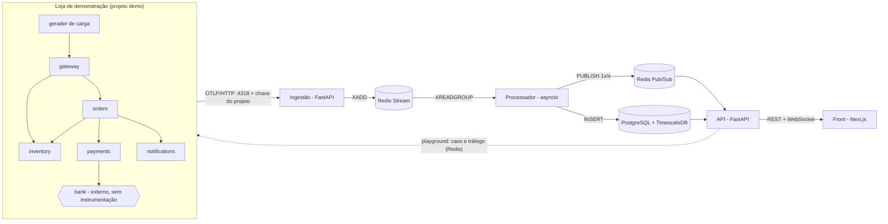

# Arquitetura do TraceFlow

O TraceFlow é uma plataforma SaaS de observabilidade (o produto está descrito em [BRIEF.md](BRIEF.md)). Ele faz cinco coisas com o que chega:

1. Recebe spans no formato OTLP (OpenTelemetry), separados por projeto e ambiente.
2. Guarda cada trace para consulta.
3. Calcula as métricas de cada serviço a cada segundo.
4. Monta o mapa de dependências a partir dos próprios spans.
5. Avalia as regras de incidente de cada projeto. Quando um serviço adoece, cruza a saúde de cada nó com o mapa para apontar a causa provável, o raio de impacto e a severidade.

## Visão geral



O caminho de escrita (ingestão, stream e processador) e o caminho de leitura (API e front) não se tocam: o que eles compartilham é o banco, o snapshot ao vivo e o canal de Pub/Sub. Se a API cair, os dados continuam chegando. Se o banco ficar lento, o stream segura os dados até o processador conseguir gravar.

## Componentes

| Componente | Tecnologia | Responsabilidade | Porta |
|---|---|---|---|
| Loja de demonstração | FastAPI + SDK OpenTelemetry | Cinco serviços que geram traces reais e aceitam falhas injetadas | gateway em 8100 |
| Gerador de carga | Python (httpx, asyncio) | Tráfego contínuo, com ritmo controlado pelo playground | – |
| Ingestão | FastAPI | Valida a chave do projeto, recebe OTLP/HTTP (protobuf ou JSON) e põe no stream | 4318 |
| Fila | Redis Stream | Desacopla quem recebe de quem processa e segura picos | 6379 |
| Processador | Python asyncio | Persiste spans, agrega métricas ao vivo, monta o mapa, avalia regras, saúde e impacto | – |
| Banco | PostgreSQL 17 + TimescaleDB 2.30 | Spans e estatísticas (TimescaleDB). Usuários, projetos, chaves, regras e incidentes (tabelas comuns) | 5432 |
| API | FastAPI + SQLAlchemy | Autenticação, projetos, consultas, regras, playground, estado ao vivo por WebSocket | 8000 |
| Front | Next.js + React + TypeScript + Tailwind + shadcn/ui | Todas as telas, com o design system do brief | 3000 |

Ingestão, processador e API são um único pacote Python (`traceflow`) com três pontos de entrada. Uma imagem Docker, três comandos.

## Produto: usuários, projetos, ambientes e chaves

- **Usuário:** e-mail e senha (hash argon2). O login devolve um JWT de curta duração num cookie `httpOnly`, que o JavaScript da página não consegue ler. Isso protege o token de roubo por XSS.
- **Projeto:** pertence a um usuário e agrupa os serviços de uma aplicação. Tudo o que o TraceFlow guarda tem `project_id`.
- **Ambiente:** vem do atributo de recurso padrão `deployment.environment.name` (por exemplo `production`, `staging`, `demo`). Todas as telas filtram por ambiente.
- **Chave de API (ingestão):**
  - Cada projeto gera chaves no formato `tf_<prefixo>_<segredo>`.
  - A chave inteira aparece **uma vez**, na criação. O banco guarda só o prefixo (para identificar) e o SHA-256 do segredo. Como o segredo é longo e aleatório, um hash rápido é seguro; senhas de usuário, que são fracas, precisam de um hash lento (argon2).
  - As aplicações enviam a chave pelo cabeçalho `Authorization`, configurado com a variável padrão `OTEL_EXPORTER_OTLP_HEADERS`.
  - A ingestão guarda o resultado da validação (chave → projeto) em cache por 60 s, para não consultar o banco a cada requisição. Uma chave revogada para de funcionar em no máximo 60 s.
- **Projeto demo:** uma conta de visitante, só leitura, abre o projeto da loja de demonstração. É por ela que recrutadores usam a demonstração online, sem criar conta.

## O caminho de um span

1. O `gateway` recebe `POST /checkout`. A instrumentação do FastAPI abre um span `SERVER` e gera o `trace_id`.
2. Cada chamada HTTP de saída (httpx) abre um span `CLIENT` e envia o cabeçalho `traceparent` (W3C Trace Context). O serviço chamado continua o mesmo trace.
3. O `BatchSpanProcessor` de cada serviço junta os spans terminados e os envia a cada 500 ms para `POST /v1/traces`, com a chave do projeto.
4. A ingestão:
   - valida a chave (com cache);
   - valida o corpo e converte JSON para protobuf, se for o caso;
   - faz `XADD` de uma entrada por requisição no stream `traceflow:spans`, com o `project_id`.

   Se o stream passar do limite, ela responde `503` com `Retry-After`, e o exportador do OpenTelemetry tenta de novo depois.
5. O processador lê lotes com `XREADGROUP`, decodifica e grava no TimescaleDB com `ON CONFLICT DO NOTHING`. Só depois disso faz `XACK`.
6. Os mesmos spans alimentam as janelas ao vivo, o mapa de serviços e o índice de traces recentes, todos separados por projeto e ambiente.
7. A cada segundo o processador monta um snapshot por projeto e ambiente (métricas, mapa, saúde, incidente aberto), grava em `traceflow:snapshot:{projeto}:{ambiente}` e publica em `traceflow:live`.
8. A API repassa cada snapshot só aos WebSockets inscritos naquele projeto e ambiente. As telas de detalhe consultam o banco por REST.

Meta: o que acontece na loja aparece na tela em 2 a 4 segundos.

## Modelo de dados

### Span normalizado

| Campo | Origem no OTLP |
|---|---|
| `project_id` | a chave de API usada no envio |
| `environment` | atributo de recurso `deployment.environment.name` (padrão `default`) |
| `trace_id`, `span_id`, `parent_span_id` | ids do span, em hexadecimal |
| `service` | atributo de recurso `service.name` |
| `name`, `kind` | nome e tipo (`server`, `client`, `internal`, `producer`, `consumer`) |
| `start_time`, `duration_ms` | `start_time_unix_nano`, `end_time_unix_nano` |
| `status` | `unset`, `ok` ou `error` |
| `http_method`, `http_route`, `http_status_code` | `http.request.method`, `http.route`, `http.response.status_code` |
| `peer_address` | `server.address` + `server.port` (spans `CLIENT`) |
| `attributes` | demais atributos, em JSONB |

### Tabelas

**Telemetria** (escrita pelo processador com asyncpg, em lote):

- **`spans`**:
  - hypertable particionada por `start_time` em blocos de 1 hora, com retenção de 3 dias;
  - chave única `(trace_id, span_id, start_time)`, que torna a gravação idempotente;
  - índices em `trace_id`, em `(project_id, environment, service, start_time DESC)` e um índice parcial para spans raiz.
- **`service_addresses`**: o catálogo de endereços (qual serviço atende cada endereço chamado), aprendido pelo pareamento e gravado pelo processador (D50).
- **Próximo passo, ainda não feito: `edge_stats_1m`**: chamadas, erros e soma de duração por minuto e por ligação, gravada com upsert que soma. É o que vai permitir o mapa de 24 h e de 3 dias (D53).

**Aplicação** (modelos SQLAlchemy, migrações com Alembic):

- **`users`**, **`projects`** e **`api_keys`** (prefixo, hash, criada em, revogada em).
- **`alert_rules`**: as regras de cada projeto (ver "Saúde e regras").
- **`incidents`** e **`incident_events`**:
  - o incidente: início, fim, severidade, causas prováveis, serviços e endpoints afetados;
  - os eventos: a linha do tempo (adoeceu, mudou a causa, recuperou), com a evidência em JSONB;
  - o resumo **antes / durante / depois** das métricas dos endpoints afetados.

Na primeira versão, as métricas históricas por serviço saem direto da tabela `spans` com `time_bucket` e `percentile_cont`. Se ficar lento, o próximo passo são continuous aggregates.

## Métricas ao vivo

- As métricas são **RED** (taxa, erros, duração), derivadas dos spans: as dos serviços vêm dos spans `SERVER`, as das arestas vêm dos spans `CLIENT`.
- A **disponibilidade** é a fração de requisições sem erro de servidor (sem 5xx) no período, por serviço e por endpoint de entrada.
- A agregação usa **o tempo do evento** (fim do span), em baldes de 1 segundo guardados por 60 segundos. O snapshot cobre os 10 segundos que terminam 3 segundos atrás. Esse atraso dá tempo para os lotes dos exportadores chegarem, e um span atrasado cai no balde certo.
- A duração é guardada num **histograma de baldes exponenciais** (fator 1,2, de 0,1 ms a 60 s, cerca de 73 baldes). O percentil sai da contagem acumulada, com erro relativo de no máximo 10%. Histogramas somam: janelas de 1 s viram 10 s ou 1 min sem perder nada, coisa que percentis prontos não permitem.

## Mapa de serviços

- **Nós** são serviços (`service.name`). **Arestas** são chamadas `CLIENT`, medidas do lado de quem chama, porque é quem sente a falha, inclusive quando o outro lado nem responde.
- **Quem é o chamado?** Um span `CLIENT` só sabe o endereço (`orders:8000`). O processador aprende o mapeamento endereço → serviço pareando cada `CLIENT` com o `SERVER` filho dele (`server.parent_span_id == client.span_id`).
- **Fora de ordem é o normal.** O `SERVER` termina antes do `CLIENT` que o chamou, e cada serviço envia em lotes no seu próprio ritmo. A primeira metade do par a chegar espera até 30 s numa "sala de espera" pelo `span_id` do cliente.
- **Nó virtual.** Um endereço que nunca pareia (API externa, serviço sem instrumentação) vira um nó virtual com o nome do endereço, como o `bank`. Um serviço conhecido que cai continua no mapa pelo nome aprendido: as chamadas até ele falham e ele não emite mais spans `SERVER`.
- **Falha de uma ligação** é resposta 5xx ou falta de resposta. Um 4xx é resposta legítima de quem foi chamado (D49).

## Saúde, regras e análise de impacto

### Regras configuráveis

Cada projeto tem as suas regras, editáveis na tela. Uma regra é:

| Campo | Exemplo |
|---|---|
| alvo | um serviço, ou `*` para todos |
| métrica | `error_rate`, `p95_ms`, `p99_ms`, `rps`, `availability` |
| condição | `>= 0.05`, ou relativa à linha de base: `>= 2x baseline` |
| janela | 10 s, 1 min, 5 min |
| mínimo de requisições | 20 (com pouco tráfego, a regra não dispara) |
| estado resultante | `degradado` ou `falhando` |

Um projeto novo nasce com as regras padrão abaixo.

### Saúde de cada nó (avaliada por snapshot)

| Estado | Regra padrão |
|---|---|
| saudável | nenhuma regra disparada |
| degradado | erro ≥ 5% (com ≥ 20 requisições na janela) **ou** p95 ≥ 2× a linha de base e ≥ linha de base + 50 ms |
| falhando | erro ≥ 25% |
| sem resposta | chamadas para ele falham por conexão ou timeout e ele não emite spans `SERVER` (fixo, não é regra) |

- A **linha de base** é uma média móvel exponencial do p95, atualizada só enquanto o nó está saudável, para a falha não virar o novo normal.
- Há **histerese**: o estado só muda depois de 3 snapshots seguidos, para o mapa não piscar.
- Um nó virtual herda a saúde das arestas que chegam nele.
- Todo serviço é avaliado também pelas ligações que chegam nele, nas regras de erro (D55): um serviço que caiu não registra erro, ele só some.

### Causa provável

1. Pegar o subgrafo dos nós não saudáveis.
2. Agrupar os ciclos em componentes fortemente conexos (Tarjan) e considerar cada grupo como um nó.
3. Os candidatos são os **sumidouros** desse subgrafo: nós doentes sem nenhuma dependência doente. Se o `payments` está lento porque o `bank` está lento, o candidato é o `bank`.
4. Cada candidato vem com evidência dos traces recentes:
   - **origem do erro**: o span com erro mais profundo, sem filhos com erro;
   - **tempo próprio**: a duração menos a dos filhos, comparado com a linha de base.

   Se a dependência doente não explica a piora de quem a chama, os dois aparecem como causa.

### Raio de impacto

- **Afetados**: ancestrais da causa no grafo (busca reversa) que estão doentes. **Em risco**: ancestrais ainda saudáveis.
- **Endpoints de entrada afetados**: o processador guarda, para os traces dos últimos 30 s, a rota de entrada e os serviços tocados. Assim ele diz, por exemplo, que `POST /checkout` passa pelo `payments` e está com 38% de erro, enquanto `GET /products` não passa e segue normal.

### Incidentes e severidade

Um incidente:
- **abre** quando um nó sai de saudável (depois da histerese);
- **é atualizado** a cada snapshot;
- **fecha** depois de 30 s com tudo saudável.

A severidade sai do impacto **em quem usa**, não do serviço que quebrou:

| Severidade | Quando |
|---|---|
| **SEV1** crítico | um endpoint de entrada com erro ≥ 25% ou sem resposta |
| **SEV2** alto | um endpoint de entrada com erro ≥ 5% ou p95 ≥ 2× a linha de base |
| **SEV3** baixo | uma dependência doente sem efeito nos endpoints de entrada (por exemplo, o `notifications` caído: as compras seguem) |

O incidente guarda a linha do tempo dos eventos e, ao fechar, o resumo **antes / durante / depois** de cada endpoint afetado: taxa, erro e p95 nos 5 minutos antes, no pior minuto e nos 5 minutos depois da recuperação.

## Incident Playground (projeto demo)

- **Cenários prontos**, cada um combinando falhas no Redis da loja:

  | Cenário | Falha injetada |
  |---|---|
  | Banco lento | +1500 ms no `bank` |
  | Pagamentos instáveis | 30% de erro no `payments` |
  | E-mail fora do ar | `notifications` down |
  | Estoque fora do ar | `inventory` down |

  Também dá para montar uma falha à mão, por serviço.
- **Tráfego:** o ritmo do gerador de carga (req/s e fração de compras) é controlado pela tela.
- **Toda falha expira sozinha** (`EXPIRE` no hash do Redis, 5 minutos por padrão). Na demonstração pública, ninguém deixa a loja quebrada para o próximo visitante.
- **Uma falha por vez** na demonstração pública, com limite de taxa por visitante.
- **O final do ciclo:** o playground mostra o incidente sendo detectado, a causa provável e, depois da recuperação, a comparação antes / depois.

## Produção (Etapa 10)

- **Métricas do próprio TraceFlow** (`traceflow/prometheus.py`, D68): cada processo serve `GET /metrics` na porta interna 9464 (no Compose, 9101 a 9103 do seu PC). Os contadores do log são lidos na raspagem; as métricas novas são histogramas:
  - `traceflow_processor_lag_seconds`: do lote chegar na ingestão até estar no banco;
  - `traceflow_processor_write_seconds` e `traceflow_processor_snapshot_seconds`;
  - `traceflow_api_request_seconds`, pelo molde da rota;
  - `traceflow_ingest_queue_age_seconds`: o freio da contrapressão (D65).

  O perfil `prometheus` do Compose sobe um Prometheus lendo os três (`deploy/prometheus.yml`).
- **Contrapressão pela idade da fila** (D65): `503` quando o lote mais antigo espera há mais de 30 s.
- **Duas gravações em andamento no processador** (D66), no mesmo processo.
- **Teste de carga** (`backend/loadtest/`, perfil `carga` do Compose): traces de 8 spans em lotes de 200, em degraus de ritmo, em modelo aberto, medindo do lado do cliente e pelo `/metrics`. Roda dentro da rede do Docker.
- **CI** (`.github/workflows/ci.yml`, D67): backend com TimescaleDB, loja e front em paralelo; depois o Playwright contra o sistema inteiro.
- **Publicação** (`deploy/`, D69): o mesmo Compose mais um complemento de produção, num servidor só, atrás de um Caddy (HTTPS automático, `/api` e `/v1/traces` no mesmo endereço do front). O `deploy/instalar.sh` prepara um Ubuntu do zero. Testada no PC atrás do Caddy; o servidor da Oracle ainda não foi criado.
- **Medido** (i5-9400F, 6 núcleos, 16 GB, tudo na mesma máquina):
  - até 4 mil spans/s, atraso p95 até o banco abaixo de 0,5 s;
  - 8 mil spans/s, 1,5 s;
  - 14,7 mil spans/s gravados com 16 mil oferecidos, com o gerador já no limite (o teto é maior);
  - antes da D66, o teto era 8,3 mil spans/s.

## O Incident Playground (Etapa 9)

- **Loja:** o gerador de carga relê o hash `demo:traffic` a cada segundo (D62).
- **API** (`api/playground.py`, ligada ao Redis do caos por `TRACEFLOW_PLAYGROUND_REDIS_URL`):
  - os 4 cenários do desenho, cada um com a causa e a severidade esperadas e o que observar;
  - a falha manual: lentidão, erros ou fora do ar, num serviço da loja (o gateway fica de fora);
  - uma falha por vez (`SET NX`), prazo de 1 a 5 min e um limite por endereço (D61);
  - o tráfego (1 a 60 req/s, 0 a 90% de compras), que volta ao padrão em 10 min;
  - o experimento em andamento e o último, com a causa esperada (D63).
- **Front** (`/projects/{id}/playground`):
  - **de um lado,** os cenários, a falha manual e o tráfego;
  - **do outro,** a falha em andamento, o ciclo do incidente passo a passo (injetada, detectada, causa conferida, severidade conferida, fim da falha, recuperação, resolvido), a faixa do incidente e o mapa ao vivo;
  - a causa e a severidade que não batem ficam "até agora" enquanto a falha vale e por 15 s depois do fim; só então viram erro, porque o incidente nasce leve e piora;
  - numa coluna só (celular), a tela rola até o ciclo quando a falha começa; no Playground, os avisos no canto ficam desligados;
  - em projeto próprio, a tela leva ao Playground da demonstração (D64).
- **Medido** (cenário "Pagamentos instáveis", pela tela):
  - o incidente abriu 7 a 9 s depois da injeção, com a causa payments, em 6 rodadas;
  - ele abre como SEV2 e sobe para SEV1 entre 5 e 18 s depois;
  - encerrando a falha uns 8 s depois de detectar, o incidente durou 51 a 54 s;
  - o gerador obedeceu ao novo ritmo em menos de 3 s.

## Os incidentes (Etapa 8)

- **Processador** (`incidents/`):
  - `rules.py`: as regras e a avaliação; `DEFAULT_RULES` são as 3 regras padrão;
  - `health.py`: a histerese (3 retratos diferentes do estado atual) e a linha de base do p95 (D54);
  - `engine.py`: a cada segundo, a saúde de cada nó pelos dois lados (o que ele registrou e as chamadas que chegam nele, D55), dos nós externos pelas ligações, e as linhas de base das rotas de entrada;
  - `analysis.py`: a causa provável (sumidouros do subgrafo doente com Tarjan, mais os doentes que as dependências não explicam), o raio de impacto e a severidade pelas rotas de entrada;
  - `tracker.py`: o ciclo do incidente, a linha do tempo e a gravação idempotente (D56);
  - o agregador ganhou as rotas de entrada (`entrypoints`) e por quais nós cada uma passou;
  - o retrato ganhou `health` (os nós que não estão saudáveis, com o motivo) e `incident` (o aberto).
- **Migração `0004`:** `alert_rules` (as 3 padrão para todo projeto), `incidents` e `incident_events`.
- **API:** `GET/POST/PATCH/DELETE .../rules` (escrita só para o dono, D60), `GET .../incidents` e `GET .../incidents/{id}`, com a evidência dos traces e o antes / durante / depois (D57).
- **Front:**
  - `/incidents`: os abertos e o histórico;
  - `/incidents/{id}`: a causa provável com o motivo, quem sente, a evidência, a linha do tempo e o antes / depois, ao vivo enquanto aberto;
  - `/incidents/rules`: as regras, com formulário para o dono;
  - a faixa do incidente no dashboard, no mapa e na página do serviço;
  - no mapa, a cor da saúde e a marca da causa provável;
  - a contagem no menu e o aviso no canto quando um incidente abre ou resolve (D58);
  - a moldura responsiva (D59).
- **Não feito nesta versão:**
  - a janela configurável por regra (é a do retrato, 10 s);
  - o tempo próprio como segunda evidência.
- **Medido** (os 4 cenários do desenho, contra o sistema rodando):
  - pagamentos instáveis: abriu em 8,7 s, causa payments, SEV1;
  - banco lento: 9,1 s, causa bank:8000 (externo), SEV2;
  - e-mail fora do ar: 9,2 s, causa notifications, SEV3;
  - estoque fora do ar: 7,2 s, causa inventory, SEV1;
  - todos resolvem 46 a 50 s depois de a falha acabar;
  - o aviso no canto da tela aparece uns 10 s depois da falha.

## O mapa de serviços (Etapa 7)

- **Processador:**
  - `live/topology.py`: o catálogo de endereços. Pareia cada `CLIENT` com o `SERVER` filho numa sala de espera de 30 s e aprende "o endereço X é o serviço Y" (D9);
  - o agregador conta as ligações pelos spans `CLIENT`, em baldes de 1 s, com falha = 5xx ou sem resposta (D49);
  - o retrato ganha `edges` (quem chama, quem é chamado ou o endereço, se é virtual, taxa, falha, p50, p95), o `entry_rps` de cada serviço e a lista `unresponsive` (D51);
  - o catálogo é gravado em `service_addresses` e carregado ao subir (D50).
- **API:** `GET /api/projects/{id}/map?environment&since&until`, com o mesmo formato do retrato e percentis exatos (D53).
- **Front:** `/projects/{id}/map`:
  - React Flow para o desenho e dagre para o layout em camadas (D52);
  - os nós externos tracejados, "sem resposta" em vermelho e as ligações com falha acima de 5% em âmbar, sempre com ícone;
  - a tabela "Chamadas entre serviços" com os mesmos números;
  - clicar num serviço abre a página dele.
- **Medido:**
  - as 6 ligações da loja aprendidas sozinhas, e o `bank` como nó externo;
  - `GET /map` de 1 h em 82 ms;
  - montar o retrato com as ligações: 5,2 ms com a loja (antes, 3,7 ms) e 45 ms com 60 serviços;
  - com o notifications fora do ar e o processador reiniciado, ele continuou reconhecido e marcado "sem resposta".

## O dashboard ao vivo (Etapa 6)

- **Processador** (`live/`):
  - `histogram.py`: 73 baldes exponenciais (0,1 ms a 60 s, fator 1,2), que se somam e se subtraem;
  - `aggregator.py`: RED de cada serviço em baldes de 1 s, pelo segundo em que o span `SERVER` terminou, numa roda de 60 s. A linha "entrada" conta só os spans raiz, ou seja, cada requisição de cliente uma vez;
  - **o retrato de cada segundo:**
    - cobre a janela de 10 s que termina 3 s atrás (marca d'água);
    - traz a série dos últimos 57 s, com o p95 em janela deslizante de 10 s;
    - é gravado em `traceflow:snapshot:{projeto}:{ambiente}` (vale 30 s) e anunciado em `traceflow:live`, num pipeline;
  - **o tique:** depois dos retratos, sai `{"type":"tick"}` no mesmo canal, mesmo sem tráfego (D48).
- **API:**
  - `POST /api/live/ticket` + `WS /api/live?ticket=` (D43);
  - o `LiveHub`: uma assinatura por processo, com reconexão, e uma fila de 2 mensagens por aba (D44). No tique, avisa `{"type":"idle"}` a quem não recebeu retrato (D48);
  - `GET .../services/{name}/metrics` e `.../operations`: o histórico exato (D45);
  - na busca de traces, o filtro `through` (passou pelo serviço).
- **Front:**
  - `/projects/{id}/dashboard`: blocos e gráficos da entrada, mais a tabela de serviços com tendência do último minuto;
  - `/projects/{id}/services/{name}`: o ao vivo do serviço, o histórico de 1 h, 6 h, 24 h ou 3 dias, as rotas, e os links para os traces que passaram por ali;
  - `useLive`: ticket → WebSocket → assinatura, com reconexão em espera crescente. Os estados são "ao vivo", "sem tráfego" e "sem sinal do processamento" (5 s sem nada, números apagados);
  - os gráficos seguem a D46.
- **Medido:**
  - um retrato por segundo, com uns 23 KB;
  - montar os retratos leva 3,7 ms com a loja e 32 ms com 60 serviços;
  - com a loja a 20 req/s, a entrada mostrou 20/s, o gateway 20/s e o payments cerca de 6/s.

## O front (Etapa 5)

- **`web/`:** Next.js 16 (App Router) + React 19 + TypeScript + Tailwind 4 + shadcn/ui (Radix) + TanStack Query.
  - Os tipos da API são gerados do OpenAPI (`npm run api:types`).
  - Roda no compose na porta 3000, num build `standalone` em imagem de duas fases (298 MB).
- **Telas:**
  - página inicial pública (componente de servidor);
  - login, cadastro e entrada do visitante;
  - projetos e chaves (a chave inteira aparece só na criação, com as variáveis prontas);
  - busca de traces, com os filtros na URL e paginação por cursor;
  - o waterfall: barras listradas para spans `CLIENT`, recolher descendentes, painel de detalhes com atributos e eventos.
- **Design system:** as cores e as fontes do brief em variáveis CSS com os nomes do shadcn/ui, e a cor de cada serviço tirada de um hash do nome.
- **API:**
  - `GET .../traces`: as raízes com os números do trace inteiro, via subconsulta lateral que roda só para as linhas da página. As subconsultas levam, além do horário em volta de cada raiz, um limite fixo (a janela da busca com a mesma folga): só ele deixa o TimescaleDB descartar as partições fora da janela (corrigido na Etapa 9);
  - `GET .../traces/{id}`: a árvore montada em `traces.py`.
- **Testes:**
  - Vitest: funções puras e o componente do waterfall;
  - Playwright: visitante busca e abre um waterfall; conta nova cria projeto e chave; tela protegida manda para o login.

## Contas, projetos e chaves (Etapa 4)

- **API** (`traceflow-api`, porta 8000, `/docs`): FastAPI + SQLAlchemy assíncrono; CORS para as origens de `TRACEFLOW_CORS_ORIGINS`.
- **Migração `0002`:**
  - cria `users`, com o visitante da demonstração, sem senha;
  - acrescenta `owner_id` e `is_demo` a `projects`;
  - cria `api_keys` e `services`, este já preenchido com o que estava gravado.
- **Ingestão** (`ingest/keys.py`):
  - confere a chave antes de ler o corpo, e o projeto vai na entrada da fila;
  - cache de 60 s (10 s para chave inexistente);
  - com o banco fora, 503 para chave desconhecida, e a chave conhecida segue valendo com nova tentativa a cada 10 s;
  - single-flight por prefixo.
- **Processador:** mantém o catálogo `services` (melhor esforço, no máximo 1 vez por minuto por combinação).
- **Chave da demonstração:** vem de `TRACEFLOW_DEMO_INGEST_KEY`, e o `traceflow-migrate` a cadastra; a loja a envia por `OTEL_EXPORTER_OTLP_HEADERS`.
- **Medido:**
  - span com chave gravado no projeto e ambiente certos, e sem chave recusado com 401;
  - chave revogada recusada aos 60 s;
  - com o banco fora por 70 s, a loja seguiu aceita e uma chave nova recebeu 503.

## O processador e o banco (Etapa 3)

- **Normalização** (`normalize.py`):
  - o que as telas consultam vira coluna, o resto vai para JSONB;
  - aceita os nomes novos e os antigos das convenções HTTP;
  - remove `\x00`, converte `NaN` em texto e corta textos acima de 8 KB;
  - descarta spans fora da janela de 3 dias atrás a 10 minutos à frente.
- **Gravação** (`storage.py`): COPY para uma tabela temporária, depois `INSERT ... ON CONFLICT DO NOTHING`, numa transação. Devolve quantas linhas eram novas.
- **Laço:**
  - ao subir, relê os próprios pendentes (`"0"`), depois lê lotes novos (`">"`, até 200);
  - grava, faz `XACK` e `XDEL`;
  - a cada 10 s, roda o `XAUTOCLAIM` (pendentes parados há mais de 30 s) e escreve as estatísticas no log.
- **Falhas:**
  - erro passageiro: espera crescente, sem confirmar;
  - dado recusado: o lote é dividido ao meio até isolar a linha;
  - lote ilegível: vai para `traceflow:spans:dead`;
  - erro inesperado: o processo cai e é reiniciado (D28).
- **Esquema:** migrações Alembic, aplicadas pelo contêiner `migrate`. A `0001` cria `projects` (com o `demo`), a hypertable `spans` (partições de 1 h), os índices e a retenção de 3 dias.
- **Medido:**
  - 101 spans/s em regime, com 42 ms de atraso médio;
  - uns 4.500 spans/s esvaziando uma fila acumulada;
  - totais aceitos e gravados iguais depois de `kill -9` no processador e de 5 min de banco fora.

## A ingestão (Etapa 2)

- `POST /v1/traces` aceita protobuf e JSON, com gzip opcional. A resposta de sucesso vai no mesmo formato da requisição.
- O corpo é lido em pedaços e recusado acima de 4 MB (`413`). O limite vale também depois de descomprimir, contra bombas de compressão.
- O OTLP/JSON traz os ids em hexadecimal, e não em base64 como o mapeamento padrão do protobuf. A ingestão converte antes de validar.
- Lote vazio responde `200` sem tocar na fila.
- Fila acima do limite ou Redis indisponível: `503` com `Retry-After`. O exportador do OpenTelemetry respeita o tempo pedido.
- Na fila: `project`, `received_at_ms`, `span_count` e `payload` (protobuf). O formato é definido em `traceflow/streams.py`, compartilhado com o processador.
- A cada 10 s, o log mostra spans/s aceitos, o tamanho da fila e as recusas por motivo.

## A loja de demonstração (Etapa 1)

- Um pacote (`demo/`, `shop`), uma imagem e um módulo por serviço. Cada contêiner sobe um módulo com uvicorn.
- A telemetria é configurada só pelas variáveis padrão do OpenTelemetry (`OTEL_EXPORTER_OTLP_TRACES_ENDPOINT`, `OTEL_BSP_SCHEDULE_DELAY=500`, `OTEL_SEMCONV_STABILITY_OPT_IN=http`). Trocar o destino dos spans é só mudar o compose.
- Os spans internos `http send`/`http receive` da instrumentação ASGI ficam desligados. Uma compra gera 10 spans: 5 `SERVER` e 5 `CLIENT`.
- Toda chamada entre serviços tem timeout de 2 s. Falha de conexão vira 502, timeout vira 504, 5xx vira 502, e o 4xx volta para a rota decidir.
- O `notifications` é uma dependência **não crítica**: se falhar, o pedido sai com `notified=false` e a falha fica só no span `CLIENT`.
- O gerador de carga é de modelo aberto (ritmo fixo, sem esperar respostas), para não cair em *coordinated omission*. Por padrão manda 20 req/s, com 30% de compras e 2% de produtos inexistentes (404).
- As falhas ficam em duas camadas. O **"fora do ar"** fica por fora da instrumentação: responde 503 sem gerar span, como o balanceador na frente de um serviço caído. O **atraso e o erro** ficam por dentro e aparecem no span.

## API

| Método | Rota | Para quê |
|---|---|---|
| POST | `/api/auth/register`, `/api/auth/login`, `/api/auth/demo`, `/api/auth/logout`, `/api/auth/logout-all` | conta, visitante da demonstração e sessão (cookie `httpOnly`) |
| GET | `/api/auth/me` | quem está logado |
| GET/POST/PATCH/DELETE | `/api/projects` | projetos do usuário |
| GET/POST/DELETE | `/api/projects/{id}/keys` | chaves de ingestão (a chave inteira só aparece na criação) |
| GET | `/api/projects/{id}/environments` | ambientes vistos nos spans (do catálogo) |
| GET | `/api/projects/{id}/services?environment` | serviços vistos (do catálogo); o estado atual vem pelo WebSocket |
| GET | `/api/projects/{id}/services/{name}/metrics?environment&since&until` | séries RED e disponibilidade, com percentis exatos e cerca de 60 pontos |
| GET | `/api/projects/{id}/services/{name}/operations?environment&since&until` | as rotas do serviço, com o RED de cada uma |
| GET | `/api/projects/{id}/traces?environment&service&through&operation&status&min_duration_ms&since&until&limit&cursor` | busca de traces (pelos spans raiz; `through`: passou pelo serviço), paginada por cursor |
| GET | `/api/projects/{id}/traces/{trace_id}?around` | todos os spans de um trace, em árvore, com o tempo próprio (waterfall) |
| GET | `/api/projects/{id}/map?environment&since&until` | o mapa de um período (até 6 h): serviços, ligações e nós virtuais |
| GET/POST/PATCH/DELETE | `/api/projects/{id}/rules` | regras de incidente |
| GET | `/api/projects/{id}/incidents`, `/api/projects/{id}/incidents/{iid}` | incidentes, linha do tempo e antes / depois |
| GET | `/api/playground` | os cenários, a falha em andamento, a última e o tráfego |
| POST | `/api/playground/scenarios/{id}` | inicia um cenário (409 se já há falha; 429 no limite) |
| POST/DELETE | `/api/playground/faults` | inicia uma falha manual / encerra a falha em andamento |
| PUT/DELETE | `/api/playground/traffic` | muda o ritmo do gerador de carga / volta ao padrão |
| GET | `/api/pipeline` | saúde do próprio TraceFlow: spans/s, atraso do stream, pendentes |
| GET | `/metrics` | as mesmas métricas do pipeline, no formato do Prometheus |
| POST | `/api/live/ticket` | ticket de uso único para abrir o WebSocket (vale 30 s) |
| WS | `/api/live?ticket=` | o cliente assina um projeto e ambiente; recebe o retrato atual e um novo por segundo |

A documentação interativa da API sai sozinha do FastAPI, em `/docs`.

## Front

- **Pilha:**
  - Next.js (App Router) com React e TypeScript;
  - Tailwind CSS e shadcn/ui para o design system;
  - Recharts para os gráficos e React Flow para o mapa;
  - TanStack Query para as chamadas REST.
- **Design system:** tokens de cor e tipografia do brief: fundo `#0B1020`, superfícies em azul grafite, primária `#3B82F6`, verde saudável, vermelho crítico, Inter e JetBrains Mono. Ficam em variáveis CSS que o Tailwind e o shadcn/ui usam.
- **Telas:**
  - página inicial pública;
  - login;
  - projetos e chaves;
  - dashboard ao vivo;
  - serviço;
  - mapa;
  - traces e waterfall;
  - incidentes;
  - regras;
  - playground.
- As telas do produto são componentes de cliente (`"use client"`), porque vivem de dados ao vivo. A página inicial pública é renderizada no servidor, para carregar rápido e ser indexada.

## Qualidade e entrega

| Camada | Ferramenta | O que cobre |
|---|---|---|
| Python | pytest, ruff, mypy | algoritmos (histograma, pareamento, causa provável, regras), rotas, ingestão |
| Front, unidade | Vitest + Testing Library | componentes e formatação de dados |
| Ponta a ponta | Playwright | login, ver o dashboard, injetar uma falha no playground e ver o incidente abrir |
| Carga | gerador próprio (`backend/loadtest`) | spans/s suportados e atraso do pipeline, com números no README |
| CI | GitHub Actions | tudo acima a cada push; imagens Docker construídas |
| Demonstração pública | front na Vercel, backend num serviço de contêineres | projeto demo aberto a visitantes, falhas com expiração (D24) |

## Estrutura do repositório

```
backend/                 pacote traceflow (ingest, processor, api, storage, migrations)
  src/traceflow/
  tests/
demo/                    loja de demonstração, middleware de caos, gerador de carga
web/                     front Next.js + TypeScript
docs/                    brief, arquitetura e decisões
docker-compose.yml
```

## Etapas

| Etapa | Entrega | Fase do brief |
|---|---|---|
| 0 ✓ | Arquitetura e decisões | Foundation |
| 1 ✓ | Loja de demonstração instrumentada, rodando no Docker Compose e conferida num Jaeger provisório | Telemetry |
| 2 ✓ | Ingestão OTLP → Redis Stream, com ambiente e projeto padrão | Telemetry |
| 3 ✓ | Processador → TimescaleDB, com idempotência e recuperação de pendentes; banco da aplicação com SQLAlchemy e Alembic | Telemetry |
| 4 ✓ | Autenticação, projetos, chaves de API e ambientes; a ingestão passa a exigir chave | Foundation |
| 5 ✓ | Front: Next.js, design system, login, projetos, busca de traces e waterfall | Foundation + Tracing |
| 6 ✓ | Dashboard ao vivo (histogramas, snapshot, WebSocket, disponibilidade) e a tela de serviço | Dashboard |
| 7 ✓ | Mapa de serviços (pareamento, nós virtuais) | Advanced |
| 8 ✓ | Incidentes: regras configuráveis, saúde, causa provável, raio de impacto, severidade, antes / depois | Tracing & Incidents |
| 9 ✓ | Incident Playground: cenários, controle de tráfego, falhas com expiração | Advanced |
| 10 ✓ | Produção: CI, teste de carga, `/metrics`, README com GIF; a publicação está pronta e aguarda o servidor | Production & Portfolio |

O brief estima 12 semanas com dedicação parcial.

## Limites conhecidos

- **Um processador só.** Para escalar é preciso particionar o stream por `trace_id`, para que os spans de um trace caiam sempre no mesmo consumidor (o mesmo papel das partições do Kafka).
- **Sem amostragem.** A loja envia 100% dos traces.
- **Projetos com um dono só.** Não há times nem papéis (dono, membro, leitor). É o próximo passo natural do modelo de projetos.
- **Estado ao vivo em memória.** Ao reiniciar, o processador refaz as janelas em cerca de 10 s e reaprende o mapeamento de endereços.
- **A causa provável é uma heurística.** Ela mostra correlação, e por isso cada causa vem com a evidência e pode haver mais de uma.
- **Regras por limiar.** Não há detecção de anomalia estatística (sazonalidade, previsão).
